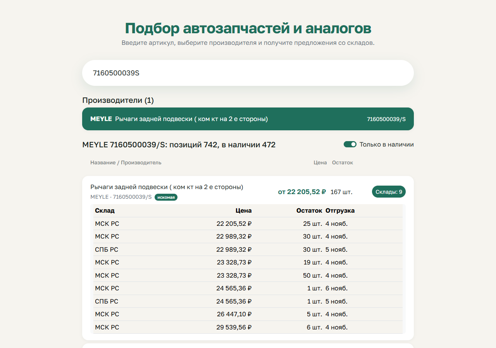

# Подбор автозапчастей и аналогов

Тестовое задание: поиск производителей, аналогов и складских предложений через API «Проценка» favorit-parts.ru ([документация](https://lk.favorit-parts.ru/static/wsprice.pdf)).

**Демо:** https://dolzha.github.io/favorit-parts-search/



## Как пользоваться

1. Введите артикул: поиск производителей запустится сам через 0,5 с или сразу по Enter.
2. Выберите производителя: появятся сама деталь и аналоги с ценой и остатком. Склады позиции раскрываются по кнопке.

Артикул для проверки: `7160500039S` (742 позиции).

## Стек

- React 18, Redux Toolkit (`createSlice`, `createAsyncThunk`)
- Bootstrap 5 и немного своих стилей
- Vite, JavaScript без TypeScript

## Запуск

```bash
npm install
npm run dev
```

Используется демо-ключ из документации. Свой ключ можно указать в `.env.local`:

```env
VITE_FAVORIT_KEY=ваш-ключ
```

## Особенности API

- **Цена.** Берётся со склада (`warehouses[].price`): поле `price` товара в документации помечено «НЕ ИСПОЛЬЗОВАТЬ». В списке показана минимальная цена среди складов.
- **Ошибки.** Приходят полем `error` при HTTP 200, кроме `Request quota exceeded!`: она приходит с кодом 403, в документации этого нет. Тело ответа разбирается до проверки статуса, поэтому пользователь видит понятный текст.
- **«Не найдено».** Вместо пустого массива приходит одна пустая запись с нулевым `goodsID`.
- **Номер на втором этапе.** Берётся из ответа API, а не из поля ввода: на `01089` у CAFFARO номер `01-89`, и с введённым номером деталь приходит пустой.
- **Большие ответы.** На один артикул приходят сотни аналогов, поэтому одна строка на позицию, фильтр «Только в наличии» и показ по 50 строк.
- **Запросы.** Параметры кодируются через `URLSearchParams` (бренд `Meat & Doria`). Прошлый запрос отменяется через `AbortController`, устаревшие ответы отбрасываются по `requestId`.

## Структура

```text
src/
├── api.js              запросы к API и разбор ответов
├── store.js            Redux-слайс, thunk-и, статусы загрузки
├── themes.css          свои стили поверх Bootstrap
└── components/
    ├── SearchInput.jsx поле артикула с задержкой запроса
    ├── BrandList.jsx   этап 1: производители
    ├── OffersTable.jsx этап 2: позиции, фильтр наличия, склады
    └── Status.jsx      загрузка, ошибки, пустой ответ
```
